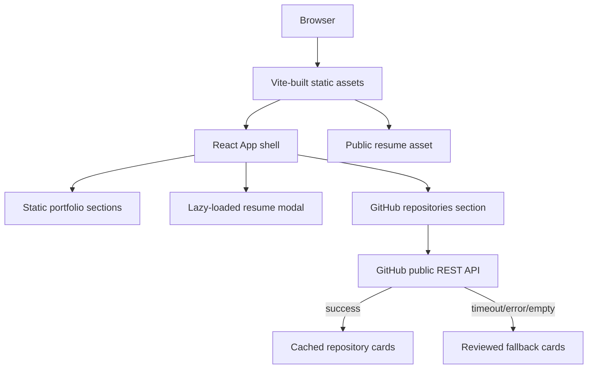

# Portfolio Architecture

## Overview

The portfolio is a client-side React/TypeScript single-page application built
with Vite. It has no application server or database in this repository.

## Components

- `src/main.tsx` mounts the React application.
- `src/App.tsx` composes the navigation, hero, about, projects, skills,
  experience, GitHub, education, contact, footer, and resume modal sections.
- `src/components/` contains presentational and interaction components. The
  resume modal is loaded lazily so the initial bundle does not load it until
  requested.
- `src/config/site.ts` is the single source for public identity, links, SEO
  text, and the GitHub username.
- `src/services/github.ts` reads public repository metadata from GitHub with a
  six-second request timeout, a five-minute in-memory cache, request
  de-duplication, and a curated fallback when the API is unavailable.
- `public/` contains static browser assets, including the resume referenced by
  the UI.

## Runtime data flow

1. Vite serves the static bundle.
2. React renders the portfolio sections from local configuration and content.
3. The GitHub section loads when it approaches the viewport.
4. The browser requests public repositories for `raja-varun`.
5. Successful results are cached in memory for the current page session. If the
   request fails or returns no repositories, the fallback list is displayed and
   the UI identifies the fallback state.

No GitHub write token, server-side secret, or private repository access belongs
in this application.

## Build and deployment

- `npm run dev` starts the Vite development server.
- `npm run lint` runs Oxlint.
- `npm run build` runs TypeScript project compilation and the Vite production
  build.
- `npm run preview` serves the generated `dist/` bundle locally.

The README and repository metadata identify a Vercel deployment. Deployment is
static hosting of the built bundle; no backend service is required.

## Privacy and maintenance boundaries

Public contact information and the resume are intentionally included assets.
Local `.opencode/` data, logs, dependency folders, build output, and OS
artifacts must remain ignored. Repository fallback content must contain only
verified URLs and claims; live GitHub metadata is preferred whenever available.
